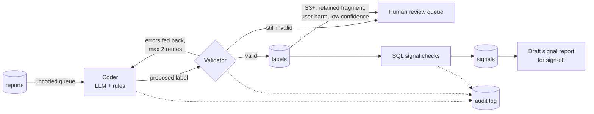

# PMS signal agent: AI coding + SQL signal detection for medical device complaints

An auditable agent that takes medical device adverse event reports, codes each one with an LLM
against written rules, checks every answer with a validator (sending errors back for a retry),
stores the results in a SQL database and runs SQL signal checks for post-market surveillance (PMS).

It builds on **[catheter-pms-ai](https://github.com/Parsavafaei26/catheter-pms-ai)**, where the coding
rules were written and the AI labels were compared with a blinded manual review of 100 reports
(93% agreement on failure mode, Cohen's kappa 0.90).

## What it found (replay run, 300 FDA MAUDE reports for long-term central venous catheters, 2023-2025)

- **Septum leak and air-entry clusters** flagged automatically by SQL in 2023 Q3-Q4: the component
  problem that the failure-mode codes alone are too coarse to show.
- **Sudden rises** in kinking (FM04) and pre-use packaging/assembly defects (FM08) in 2025:
  at least double the previous four quarters.
- **19 serious events** (critical harm, retained fragments, harm to staff) listed for individual review.
- **Retained fragments come mainly from removal:** 6 of 15 were catheters breaking as they were
  pulled out, and 5 were insertion accessories such as guidewires.
- **A lesson about trend rules:** the pre-set "double the previous year" rule missed the gradual rise
  of catheter breakage (28% to 49% of complaints). A share-based check, added afterwards and labelled
  exploratory, catches it. Simple count ratios are not enough for PMS trending.

Full output: [outputs/signal_report.md](outputs/signal_report.md) · SQL results: [docs/sql_results.md](docs/sql_results.md)

## How the agent works



| Part | File | What it does |
|---|---|---|
| Database | `sql/schema.sql`, `sql/seed.sql` | Reports, labels, controlled vocabularies, review queue, signals, audit log; a `complaints` view removes voided and repeat reports |
| Coder | `agent/coders.py` | `ClaudeCoder` calls the Anthropic Messages API with a forced `record_label` tool so answers come back as structured fields; `ReplayCoder` replays the validated labels from project 1 |
| Validator | `agent/validator.py` | Rejects values outside the rules, a secondary code equal to the primary, a missing supporting quote, and FM08 outside P1/P2; decides what a person must review |
| Agent loop | `agent/agent.py` | Code, validate, retry with feedback, store, route, then run signal checks; every step written to `audit_log` |
| Signal checks | `sql/signals.sql` | Rising failure mode (rolling 4 quarters vs previous 4), component keyword clusters, serious events, exploratory share shift |
| Report | `agent/report.py` | Review queue CSV and a draft signal report with a sign-off block |
| Live evaluation | `scripts/live_eval.py`, `agent/evaluate.py` | Runs real models on the 100 manually reviewed reports and scores them (agreement, Cohen's kappa) next to the earlier AI runs; records tokens, cost and time per call |
| Tests | `tests/test_agent.py`, `tests/test_live.py` | 21 tests, including the retry loop, cost tracking, the spending cap and rate-limit retries against a simulated API |

**Design choices for a regulated setting:** the orchestration is fixed code, not left to the model,
so every run is repeatable and auditable. The model only makes the coding decision, inside a
schema it cannot step outside. Thresholds are fixed in `agent/config.py` before a run and printed in
every report. Nothing is a regulatory decision: the output is a draft for a person to sign off.

## Run it

Python 3.10+, no external packages.

```
python3 run.py                    # replay mode: no API key needed
python3 -m unittest -v            # tests
python3 scripts/run_questions.py  # example SQL questions -> docs/sql_results.md
```

## Live run with a real model (built and tested; waiting for API credit)

The live path is ready to run. It needs an Anthropic API key with credit (paid per use, separate
from a Claude subscription).

```
cp .env.example .env              # then paste the key into .env (.env is git-ignored)
python3 scripts/live_eval.py --list-models    # confirm the model ids your key can use
python3 scripts/live_eval.py --dry-run        # cost estimate, nothing is spent
python3 scripts/live_eval.py                  # step 1: two models on the 100 reviewed reports
python3 run.py --coder claude --model <better model>   # step 2: full agent run on all 300
```

**Step 1** compares a small and a large model on the 100 reports that were coded by hand without
seeing any AI label, using the same agreement measures as project 1, and puts them next to the two
earlier AI runs (rules v1.1 and v1.2). **Step 2** runs the whole agent on all 300 reports with the
better model; its signal report and review queue are written to `outputs/live/`, next to the
replay outputs, so the two runs can be compared.

**Cost controls:** the coding rules are sent with prompt caching, so after the first call they are
read from cache at a tenth of the input price; every call's tokens and cost are logged; and each run
stops before it passes a spending cap (`--max-cost`, default $3). The dry-run estimate at October
2026 prices is about $0.03 for the small model and $0.60 for the large one on the 100 reports.
Results go to `outputs/live/`.

## Honest limits

- **The published results come from replay mode.** The labels being replayed were produced by
  Claude in project 1 and compared with the manual review there. The live path is implemented and
  tested against a simulated API, but has not yet been run with a real key.
- The manual review is one reviewer's coding, so it is a reference, not ground truth.
- The keyword watchlist terms were chosen after the project 1 review, so the cluster check
  confirms a known cluster rather than discovering it blind. In practice the watchlist would come
  from the risk file.
- 25 reports per quarter is a small sample: signals are prompts for investigation, not conclusions.
- MAUDE limitations apply: under-reporting, duplicates, allegations rather than confirmed causes,
  no denominator. Results must not be used to compare manufacturers.

## Author

Parsa Vafaei, MSc Biomedical Engineering (University of Sheffield) · Regulatory affairs and quality
